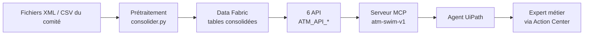

# SWIM SENEGAL

**AI Agents Challenge — Innovation Days 2026 — Fiche 004 ATM / SWIM / AIXM 5.1**

> Données fictives de démonstration. Aucun lien avec les bases ou systèmes de production de l’ASECNA. Ne pas utiliser pour la navigation, la sécurité, le recrutement ou une décision opérationnelle.

## Contexte

Le comité scientifique de l’AI Agents Challenge (Innovation Days 2026, ERNAM – Dakar) propose la fiche 004 « ATM / SWIM / AIXM 5.1 ». Le jeu de données fourni est volontairement petit : deux aérodromes, deux pistes, trois espaces aériens, trois aides radio et trois changements. Le fichier XML du comité se déclare `AIXM-inspired-SYNTHETIC-NOT-AIXM-5.1-CONFORMANT` : il est inspiré des concepts AIXM, mais il n’est pas conforme à AIXM 5.1. Le schéma XSD de ce dépôt est un schéma maison, écrit pour contrôler la structure de ce fichier de démonstration.

## Ce que fait la solution

La solution importe le jeu de données aéronautiques fictif du comité (CSV et XML) sans le modifier. Le script de prétraitement contrôle la structure, valide le XML contre un schéma maison et consolide chaque table avec la valeur valide et le changement associé. Les CSV consolidés sont importés dans UiPath Data Fabric et exposés en lecture seule par six API. Un serveur MCP `atm-swim-v1` publie ces outils à l’agent UiPath, qui répond en citant ses sources et en signalant les changements non validés. Lorsqu’une anomalie, un désaccord ou une demande de modification est détecté, l’agent crée une tâche dans Action Center et l’expert métier valide la réponse.

## Architecture



## Arborescence commentée

```text
hackaton-asecna/
├── README.md
├── .gitignore
├── donnees/
│   ├── brutes/            # fichiers du comité, jamais modifiés
│   └── pretraitees/       # CSV consolidés importés dans Data Fabric
├── pretraitement/         # script Python + rapport de validation
├── agent/                 # System prompt + description de l’escalade
├── api/                   # documentation des outils
├── evaluation/            # 18 questions officielles, recette et résultats
└── docs/                  # PDF et schéma d’architecture
```

## Prérequis

- UiPath Data Fabric.
- UiPath Integration Service.
- UiPath Action Center.
- Un environnement UiPath permettant d’exécuter l’agent et le serveur MCP `atm-swim-v1`.
- Python 3.10 ou supérieur et la bibliothèque `lxml` pour le prétraitement.
- Les fichiers bruts listés dans `donnees/brutes/README.md`.

## Reproduire en étapes

1. Vérifier la présence des fichiers bruts dans `donnees/brutes/` et ne pas les modifier.
2. Exécuter le prétraitement avec une date de référence explicite :
   ```bash
   python3 pretraitement/consolider.py --date-reference 2026-11-26
   ```
3. Contrôler `pretraitement/rapport_validation.md` et les CSV produits dans `donnees/pretraitees/`.
4. Importer les CSV consolidés dans les entités Data Fabric. Noms techniques des entités : À COMPLÉTER.
5. Déployer les six API et le serveur MCP `atm-swim-v1`. URL, transport et authentification : À COMPLÉTER.
6. Configurer l’agent UiPath avec `agent/system_prompt.md`, `agent/user_prompt.md` et les outils documentés dans `api/outils/`.
7. Configurer l’application de revue Action Center avec les champs `Content` et `Comment`.
8. Poser les 18 questions officielles et remplir `evaluation/resultats.csv` selon la méthode décrite dans `evaluation/README.md`.

## Résultats

Les questions officielles, les questions adversariales, les questions de recette et la méthode d’évaluation sont dans [`evaluation/`](evaluation/). Un run partiel de 5 tests (nuit du 24 au 25 novembre 2026) est consigné : 5 tests réussis sur 5, soit 100 % sur ce run partiel. Les 18 questions officielles ne sont pas encore toutes mesurées. Voir [`evaluation/questions_recette.csv`](evaluation/questions_recette.csv), [`evaluation/bilan_tests_2026-11-24.md`](evaluation/bilan_tests_2026-11-24.md) et [`evaluation/resultats.csv`](evaluation/resultats.csv).

## Garde-fous

- Lecture seule : l’agent consulte les données, il ne les modifie pas.
- Aucune décision opérationnelle : l’agent ne guide pas un aéronef et ne remplace pas un NOTAM ou une publication officielle.
- L’agent propose et l’expert métier valide via Action Center.
- Toute demande de création, de modification ou de suppression est escaladée.
- Les changements `EN_ATTENTE` ou `REJETEE` ne sont jamais présentés comme valides.
- Aucun secret, mot de passe, jeton ou clé ne doit être stocké dans le dépôt.

## Limites assumées

- Petit jeu de données : deux aérodromes, deux pistes, trois espaces aériens, trois aides radio et trois changements.
- Compte nominatif en démonstration : l’authentification et la gestion des habilitations ne sont pas industrialisées.
- XSD maison : le schéma fourni contrôle uniquement la structure du fichier de démonstration.
- Pas de validation XSD AIXM officielle : le fichier n’est pas déclaré conforme AIXM 5.1.
- Les API et le serveur MCP sont des composants de démonstration, non certifiés SWIM.

## Équipe

Équipe : À COMPLÉTER (noms, rôles, organisation).

---

**Données fictives de démonstration.** Ce dépôt ne contient aucun secret et ne doit pas être utilisé en exploitation.
