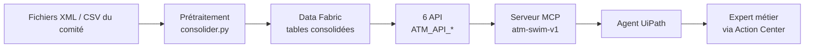

# Architecture — SWIM SENEGAL

## Explication en 10 lignes

1. Les fichiers XML et CSV du comité sont copiés dans `donnees/brutes/` et restent inchangés.
2. `pretraitement/consolider.py` lit ces fichiers avec une date de référence explicite.
3. Le script contrôle la structure, les identifiants, les références et la cohérence de l’historique.
4. Le fichier XML est validé contre `pretraitement/schema_demo.xsd`, un schéma maison qui n’est pas un schéma AIXM 5.1 officiel.
5. Chaque table est consolidée avec la valeur valide à la date de référence et une colonne `changement_associe`.
6. Les CSV consolidés sont importés dans UiPath Data Fabric.
7. Six API en lecture seule exposent les aérodromes, les espaces aériens, les changements, les anomalies, l’état du jeu et la recherche.
8. Le serveur MCP `atm-swim-v1` publie ces six outils à l’agent UiPath.
9. L’agent applique cinq étapes : état des données, anomalies, donnée demandée, changements associés, réponse ou escalade.
10. En cas d’anomalie, d’écart, de demande de modification ou de correction envisagée, l’agent crée une tâche Action Center et l’expert métier valide.

## Précisions

- L’agent est en lecture seule et ne prend aucune décision opérationnelle.
- Les données sont fictives de démonstration.
- Les noms techniques des entités Data Fabric, l’URL du serveur MCP et les paramètres de déploiement sont à compléter dans l’environnement UiPath.
